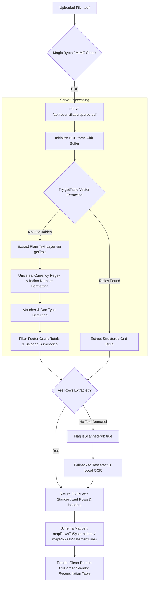

# PDF & Financial Statement Ingestion Architecture & Tooling

This document outlines the tools, root cause analyses, and solutions implemented for processing PDF and financial statements (ERP Ledgers and Customer/Vendor Statements) accurately.

---

## 1. Summary of Issues Identified & Fixed

### Issue 1: Corrupted Binary Characters (`??L7fqe7<99V`)
* **Symptom:** In ERP Statement or Statement tables, the Document / Reference No. column showed unreadable question mark glyphs (``).
* **Root Cause:** The previous client-side parser was attempting to decode the raw binary bytes of `.pdf` files as a UTF-8 string via `new TextDecoder("utf-8").decode(bytes)`. Real-world PDFs compress content streams using **FlateDecode (zlib)** and map fonts with internal glyph indexes. Reading compressed binary streams as plain text caused decompression failure, resulting in raw binary replacement characters.
* **Resolution:** Replaced raw binary decoding with a dedicated server-side PDF parsing engine using **Mozilla PDF.js (`pdf-parse` v2)**.

---

### Issue 2: Truncation of Indian Currency Amounts (`2,16,190.00` → `16,190.00`, `1,00,000.00` → `0.00`)
* **Symptom:** In financial statements with Indian number formatting (Lakhs and Crores), numbers like `2,16,190.00` were read as `16,190.00` (missing the leading `2,`), `1,63,170.00` was read as `63,170.00`, and `1,00,000.00` became `0.00`.
* **Root Cause:** The currency extraction regular expression was restricted to Western 3-digit comma grouping:
  ```typescript
  // Flawed Western-only regex:
  const amountRegex = /(\b\d{1,3}(?:,\d{3})+(?:\.\d{1,2})|\b\d+\.\d{2}\b)/g;
  ```
  In Indian numbering format:
  - After the first thousands group (`,\d{3}`), every subsequent group to the left is **2 digits** (`,\d{2}`), e.g., `2,16,190.00`, `14,60,445.00`, `1,00,00,000.00`.
  - The pattern `(?:,\d{3})+` failed to match `,16,` or `,00,`, so it only captured the trailing `16,190.00` and `00,000.00` (which parsed as `0.00`).
* **Resolution:** Implemented a **Universal Currency Regex** that accommodates both Indian numbering (Lakhs/Crores) and International grouping:
  ```typescript
  // Universal Regex:
  const amountRegex = /\b\d+(?:,\d+)*(?:\.\d{2})\b/g;
  ```

---

### Issue 3: Numeric Voucher Numbers Skipped (`6`, `13`, `22`, etc.)
* **Symptom:** Vouchers with 1-2 digits were rejected or treated as missing, falling back to dummy identifiers like `ROW-2`.
* **Root Cause:** The previous candidate token filter had `!/^\d{1,2}$/.test(w)`, mistakenly assuming vouchers must have 3+ characters.
* **Resolution:** Updated voucher detection to support both alphanumeric voucher formats (e.g. `272627MU10350`, `INV-102`) and numeric vouchers (e.g. `6`, `13`, `22`, `112`).

---

### Issue 4: Column Footer & Grand Total Row Leaks
* **Symptom:** Summary footer lines (`12,16,190.00  14,60,445.00` and `14,60,445.00  14,60,445.00`) were being ingested as real transactions.
* **Resolution:** Added intelligent footer detection that filters out lines where duplicate grand totals appear side-by-side or lines with multiple amounts that lack a transaction voucher code.

---

## 2. Tools Configured (100% Free & Open Source)

| Tool / Library | Role & Purpose | License & Cost | Runtime Location |
| :--- | :--- | :--- | :--- |
| **`pdf-parse` v2 (Mozilla PDF.js engine)** | Decompresses Flate streams, parses font CMaps, extracts vector tables (`getTable()`) and text layers (`getText()`). | MIT / Apache 2.0 (100% Free) | Server Node.js Route (`/api/reconciliation/parse-pdf`) |
| **`tesseract.js` v7** | Client-side OCR engine used as automated fallback when a PDF is a scanned document without an embedded digital text layer. | Apache 2.0 (100% Free, Zero API keys) | Local / Browser Worker |
| **Next.js `serverExternalPackages`** | Prevents Turbopack from corrupting the PDF worker binary path on Windows Node.js. | Open Source | Next.js Engine Config |
| **Intelligent Schema Mapper** | Auto-detects Date, Doc No, Voucher Type, Debit, Credit, and Amount columns, and sanitizes replacement characters (`\uFFFD`). | Internal Engine | Client / Server Shared |

---

## 3. Architecture & Data Flow



---

## 4. Key Files Modified

1. **[`src/app/api/reconciliation/parse-pdf/route.ts`](file:///c:/Users/buna2/OneDrive/Desktop/Smart-Reconciliation/src/app/api/reconciliation/parse-pdf/route.ts)**:
   - Dedicated Node.js API route that ingests `.pdf` files.
   - Configures PDF worker URL via `pathToFileURL`.
   - Uses `parseTextToFinancialRows` with universal Indian currency support (`/\b\d+(?:,\d+)*(?:\.\d{2})\b/g`).
   - Carries forward `lastSeenDate` across lines where the date is not repeated.
   - Filters out balance/grand total summary lines.

2. **[`src/lib/reconciliation/file-parser.ts`](file:///c:/Users/buna2/OneDrive/Desktop/Smart-Reconciliation/src/lib/reconciliation/file-parser.ts)**:
   - Replaced broken client-side `new TextDecoder().decode(bytes)` regex with the `/api/reconciliation/parse-pdf` route.
   - Added automated fallback to Tesseract.js if a scanned PDF is detected.

3. **[`src/lib/reconciliation/schema-mapper.ts`](file:///c:/Users/buna2/OneDrive/Desktop/Smart-Reconciliation/src/lib/reconciliation/schema-mapper.ts)**:
   - Added `sanitizeCleanField` to purge any replacement characters (`\uFFFD`).
   - Added direct mapping support for `docDate`, `docNo`, `refNo`, `debit`, `credit`, and `amount`.

4. **[`src/lib/reconciliation/ocr-extractor.ts`](file:///c:/Users/buna2/OneDrive/Desktop/Smart-Reconciliation/src/lib/reconciliation/ocr-extractor.ts)**:
   - Updated OCR line parsing amount regex to universal Indian and International formats.

5. **[`next.config.ts`](file:///c:/Users/buna2/OneDrive/Desktop/Smart-Reconciliation/next.config.ts)**:
   - Added `serverExternalPackages: ["pdf-parse", "pdfjs-dist"]` for reliable server-side execution.
